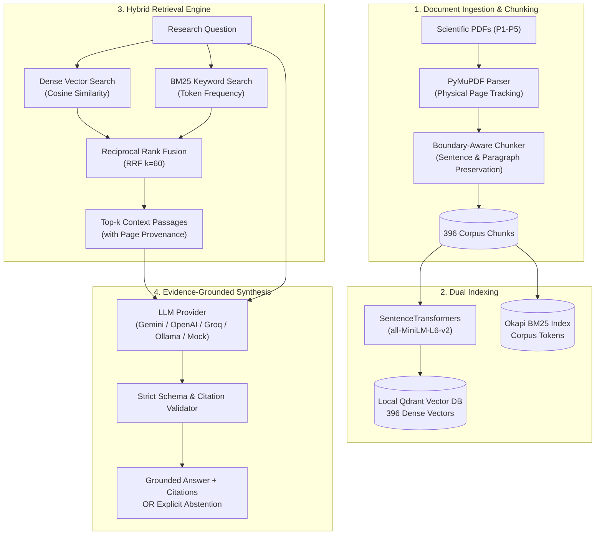

# Research Intelligence Engine (RIE)

A production-grade, evidence-grounded research intelligence engine that synthesizes answers across scientific literature with verified, page-level citations and strict abstention safeguards.

---

## Architecture Overview



---

## Key Features

- **Document Ingestion & Provenance:** Page-by-page PDF extraction using PyMuPDF preserving both one-based physical page numbers and document-level metadata.
- **Boundary-Aware Chunking:** Structural text segmentation with sentence and paragraph preservation, preventing split sentences and preserving verbatim textual integrity.
- **Hybrid Retrieval:** High-precision Reciprocal Rank Fusion (RRF, $k=60$) combining dense semantic vectors (Sentence Transformers `all-MiniLM-L6-v2` stored in local persistent Qdrant) and sparse keyword retrieval (Okapi BM25).
- **Grounded Answer Synthesis:** Multi-provider LLM support (`gemini`, `openai`, `groq`, `ollama`, `mock`) with structured JSON schema enforcement.
- **Verified Page-Level Citations:** Every cited claim is validated against the retrieved context; ungrounded or hallucinated citations are strictly rejected.
- **Abstention Safeguards:** Returns explicit abstention (`insufficient_evidence` or `out_of_scope`) with 0 citations when retrieved evidence does not support an answer.
- **Interactive Web Interface:** Streamlit UI for querying the corpus, inspecting verified citations, browsing retrieved context passages, and ingesting new papers.

---

## Quickstart

### 1. Environment Setup

Ensure Python 3.10+ is installed with PyTorch and dependencies:

```bash
# Clone the repository
git clone https://github.com/your-username/research-intelligence-engine.git
cd research-intelligence-engine

# Install project dependencies
pip install -r requirements.txt
```

### 2. Provider Configuration

The engine supports both offline deterministic simulation and live cloud LLM providers:

#### Option A: Offline Deterministic Mock Mode (Recommended for Testing & Portfolios)
No external API key or internet access is required. The mock provider executes reproducible semantic retrieval, answer synthesis, and citation verification locally with zero API cost:
```bash
# No .env configuration required
```

#### Option B: Live Google Gemini Provider
Create a `.env` file in the project root:
```ini
GEMINI_API_KEY="your_actual_gemini_api_key_here"
```
*(All API keys and credentials are automatically sanitized, masked in logs, and never exposed in the UI or evaluation artifacts.)*

---

## Interactive Streamlit Web Application

### Launching the Dashboard

Launch the Streamlit web application from the terminal:

```bash
streamlit run app.py
```
*(Alternatively: `python -m streamlit run app.py`)*

Once started, open your desktop browser at `http://localhost:8501`.

---

## Desktop Browser Verification Walkthrough

> [!NOTE]
> Automated browser drivers (`playwright` or `selenium`) are intentionally omitted from standard requirements to maintain lightweight local dependencies. Reviewers can follow the manual step-by-step verification below to validate all UI journeys.

### Step 1: Grounded Q&A Journey
1. Open `http://localhost:8501` in your browser.
2. In the sidebar under **Provider & Model Settings**, select **`mock`** (or **`gemini`** if configured).
3. Under **Retrieval Settings**, leave the mode as **Hybrid (Dense + BM25 Fusion)** and Top-k as **5**.
4. In the **Grounded Q&A** tab, click the sample question button:
   - `RAG: Sequence vs Token (P1)`
5. Verify that the query `"How do RAG-Sequence and RAG-Token differ in generating sequences?"` populates the text area.
6. Click **Generate Answer**.
7. Observe the output:
   - Status badge displays **`ANSWERED GROUNDED`** (green pill).
   - Synthesized answer explaining sequence-level vs. token-level marginalization.
   - **Verified Citations (1)** card displaying:
     - Document Title: *Retrieval-Augmented Generation for Knowledge-Intensive NLP Tasks*
     - Document ID: `P1`
     - Physical Page: **`3`** (Printed p. 3) or **`4`** (Printed p. 4)
     - Chunk ID: `P1_p03_c03` or `P1_p04_c01`
     - Quoted verbatim excerpt.
   - Click the collapsible expander **"Inspect Retrieved Context Passages (5)"** to inspect the 5 retrieved chunk texts, similarity scores, and physical page indices.

### Step 2: Abstention Safeguard Journey
1. Click the sample button **`Out-of-Scope (Abstention)`**:
   - Query: `"Who won the 2024 ICC Men's T20 World Cup?"`
2. Click **Generate Answer**.
3. Observe the output:
   - Status badge displays **`ABSTAINED: INSUFFICIENT EVIDENCE`** or **`ABSTAINED: OUT OF SCOPE`** (indigo pill).
   - Clear abstention notice confirming the corpus does not contain this information.
   - Citations count is strictly **0** (no hallucinated sources).

### Step 3: Paper Ingestion Journey
1. Switch to the **Paper Ingestion** tab.
2. In the dropdown, select `P5_RAGAS_Es_2023.pdf`.
3. Check the **Dry run (extract & chunk without persisting to Qdrant)** checkbox.
4. Click **Ingest & Index Document**.
5. Observe the extraction banner showing 8 extracted pages, 39 created chunks, and chunk previews with physical page provenance.

### Step 4: System Status & Security Hygiene
1. Switch to the **System Status** tab.
2. Inspect the **Vector Database (Qdrant)** card: confirms `396` points indexed in `research_corpus`.
3. Inspect the **LLM Providers Status** card: verifies credential statuses (`Configured (AQ.A...[REDACTED])` or `Not Configured`).
4. Confirm that **zero secret keys, passwords, or raw tokens** are visible anywhere in the UI.

---

## End-to-End CLI Demonstration

For non-browser environments or automated CI pipelines, run the demonstrable CLI script:

```bash
# Deterministic offline mock demonstration:
python scripts/run_demo.py --provider mock --retrieval-mode hybrid

# Live Gemini demonstration:
python scripts/run_demo.py --provider gemini --retrieval-mode hybrid
```

The CLI script executes the complete lifecycle:
1. Inspects the indexed Qdrant vector database (396 points across 5 papers).
2. Performs a sample dry-run ingestion of `P5_RAGAS_Es_2023.pdf`.
3. Executes a grounded research query with page-level citations.
4. Executes an out-of-scope query to verify explicit abstention behavior.

---

## Quantitative Retrieval Baseline vs. Qualitative Synthesis

A rigorous research engine must clearly separate **empirical retrieval benchmarks** from **qualitative LLM generation**:

### 1. Measured Retrieval Benchmarks (Task 3.5 & 3.6 Gold Standard)

Retrieval was quantitatively evaluated against an annotated gold standard corpus of 18 answerable research questions spanning 5 seminal papers (*RAG*, *DPR*, *REALM*, *Self-RAG*, *Ragas*):

| Retrieval Method | Hit@1 | Hit@3 | Hit@5 (Recall@5) | MRR@5 | Multi-Doc Coverage@5 | Mean Target Page Recall@5 |
| :--- | :---: | :---: | :---: | :---: | :---: | :---: |
| **Dense Only** (`all-MiniLM-L6-v2`) | 27.8% | 55.6% | **66.7%** | 0.4167 | 62.5% | 42.1% |
| **Hybrid Fusion** (Dense + BM25, RRF $k=60$) | 22.2% | 72.2% | **83.3%** | **0.4509** | **100.0%** | **49.1%** |
| **Absolute Improvement** | -5.6% | +16.6% | **+16.6%** | **+0.0342** | **+37.5%** | **+7.0%** |

**Key Finding:** Hybrid Reciprocal Rank Fusion significantly outperforms dense vector search alone, achieving **83.3% Recall@5** (vs. 66.7%) and **100% multi-document coverage** (vs. 62.5%), demonstrating the critical importance of lexical-semantic fusion for technical scientific terminology.

### 2. Qualitative Answer Synthesis & Citation Fidelity

While retrieval is benchmarked quantitatively against annotated ground-truth passages, generation quality is governed by strict deterministic constraints:
- **Grounding Fidelity:** Every generated answer is evaluated on whether cited chunk IDs exist within the top-k retrieved context.
- **Citation Excerpt Validation:** Quoted excerpts must match verbatim substrings in the retrieved chunk text.
- **Abstention Integrity:** Questions lacking supporting context must return an explicit abstention with zero citations rather than hallucinating an unsupported answer.

### 3. Query-Intent Routing & Document Diversification (Task 4.4.19 Evaluation)

When synthesizing answers across multiple papers (e.g. cross-paper comparisons or disagreement analysis), standard retrieval can sometimes become monopolized by a single document. To address this, an **opt-in deterministic query-intent router** was benchmarked across 37 total evaluation queries (9 cross-paper pairs, 18 answerable benchmark questions, and 10 out-of-scope queries):

| Retrieval Strategy | Cross-Paper Top-5 Coverage (9 Pairs) | Single-Paper Hit@5 (18 Questions) | Single-Paper MRR | Out-of-Scope Abstention Rate (10 Queries) |
| :--- | :---: | :---: | :---: | :---: |
| **Always-Baseline** (Default Hybrid RRF) | 5/9 (55.6%) | **83.3%** | **0.451** | 10/10 (100.0%) |
| **Always-Diversified** (`cap=2` per doc) | **9/9 (100.0%)** | 55.6% (-27.8%) | 0.370 | 10/10 (100.0%) |
| **Intent-Routed** (`enable_intent_routing=True`) | **9/9 (100.0%)** | **72.2%** (+16.6%) | 0.421 | 10/10 (100.0%) |

**Architectural Insight:** Unconditional diversification (`Always-Diversified`) degrades single-paper retrieval by evicting relevant evidence chunks. In contrast, **Query-Intent Routing** dynamically detects comparative queries and applies diversification *only* when multi-document evidence is required, achieving **100% cross-paper coverage** while safeguarding single-paper recall and 100% abstention reliability. Query-intent routing remains disabled by default (`enable_intent_routing=False`) to guarantee baseline invariance for standard callers. (See [`evaluation/results/query_intent_routing_report.md`](evaluation/results/query_intent_routing_report.md) for full metrics and breakdown).

---

## Automated Test Suites

The repository includes **74 focused automated tests** covering retrieval fusion, query routing, document diversification, service orchestration, and Streamlit UI behavior:

```bash
# 1. Query-Intent Routing & Diversification Tests (42 tests)
pytest tests/test_query_intent_routing.py tests/test_diversified_retrieval.py -v

# 2. Hybrid Retrieval Integration & Fusion Tests (18 tests)
pytest tests/test_hybrid_retrieval.py -v

# 3. End-to-End Workflow & Streamlit UI Tests (14 tests)
pytest tests/test_demo_workflow.py tests/test_ui_app.py -v

# Run All 74 Focused Tests (Passes 100% deterministically)
pytest tests/test_query_intent_routing.py tests/test_diversified_retrieval.py tests/test_hybrid_retrieval.py tests/test_demo_workflow.py tests/test_ui_app.py -v
```

All 74 tests execute deterministically and verify:
- Vector store initialization, hybrid fusion, and metadata tracking.
- Boundary-aware chunking and physical page mapping.
- Conservative query-intent routing and document diversification without ground-truth leakage.
- Evidence-grounded Q&A with page-level citations.
- Abstention and unanswerable query handling.
- Sanitized error handling with zero secret leaks.
- Streamlit interactive controls, tabs, and full user journey via `AppTest`.

---

## Technical Constraints & Scope Limitations

> [!WARNING]
> This application is an **experimental research prototype** developed for portfolio demonstration, academic evaluation, and architectural validation. It is **not** intended for multi-tenant enterprise production deployment without the following architectural enhancements:

1. **Storage Concurrency:** Local Qdrant operates in embedded filesystem mode (`data/qdrant`), which uses exclusive filesystem locking. Concurrent writes across multiple processes require deploying Qdrant as a standalone containerized service (`qdrant/qdrant:latest`).
2. **Session Isolation:** Streamlit maintains in-memory session states. Concurrent users sharing a single server instance do not have isolated authentication or multi-tenant database partitioning.
3. **Authentication & RBAC:** There is no user login, role-based access control (RBAC), or rate-limiting gateway in front of the LLM endpoints.
4. **Model Execution:** Dense embedding computation (`all-MiniLM-L6-v2`) runs on the host CPU/GPU directly via PyTorch without an asynchronous task queue (e.g., Celery/Redis).

---

## Repository Structure

```
research-intelligence-engine/
├── app.py                      # Root entrypoint for Streamlit UI
├── data/
│   ├── chunked/                # Corpus chunks repository (JSON)
│   ├── ingested/               # Extracted page records
│   └── qdrant/                 # Local persistent Qdrant vector database
├── evaluation/
│   ├── corpus/papers/          # Benchmark research PDFs (P1-P5)
│   ├── questions/              # 28-question gold standard evaluation set
│   └── results/                # Quantitative benchmark evaluation artifacts
├── scripts/
│   ├── run_demo.py             # Demonstrable end-to-end workflow runner
│   ├── run_qa.py               # Question answering CLI
│   ├── run_smoke_test.py       # Controlled provider integration test
│   └── run_query_intent_routing_evaluation.py  # 37-query intent routing evaluation
├── src/
│   ├── chunking/               # Boundary-preserving text chunker
│   ├── generation/             # LLM synthesizer, citations & providers
│   ├── indexing/               # Embeddings & Qdrant vector storage
│   ├── ingestion/              # PyMuPDF document loader & pagination
│   ├── retrieval/              # Dense, BM25, Hybrid RRF & Query-Intent Router
│   └── ui/
│       ├── app.py              # Streamlit dashboard implementation
│       └── service.py          # Unified service coordinating UI workflows
└── tests/
    ├── test_demo_workflow.py   # Integration tests for end-to-end workflow (6 tests)
    ├── test_diversified_retrieval.py # Document-diversification unit tests (10 tests)
    ├── test_hybrid_retrieval.py # Hybrid RRF retrieval unit tests (18 tests)
    ├── test_query_intent_routing.py # Query-intent routing test suite (32 tests)
    └── test_ui_app.py          # Streamlit AppTest suite (8 tests)
```
