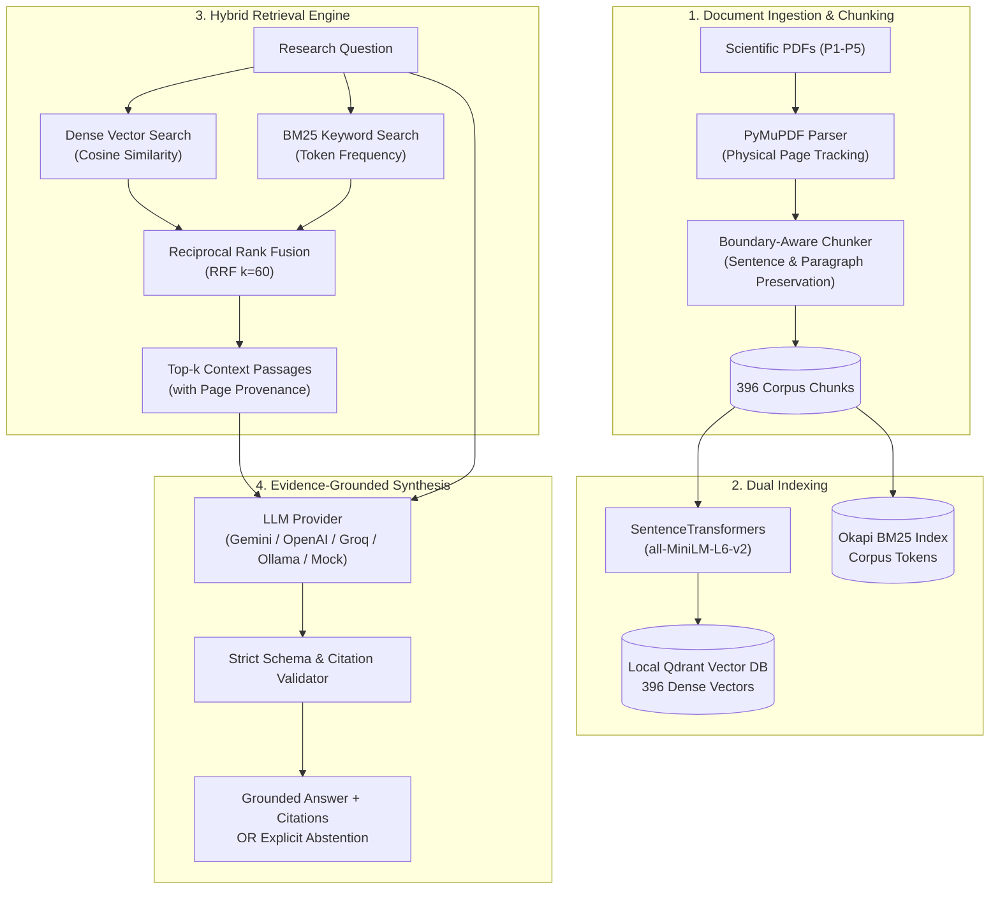

# Research Intelligence Engine (RIE)

An evidence-grounded research intelligence prototype that synthesizes answers across scientific literature with verified, page-level citations and strict abstention safeguards.

---

## Architecture Overview



---

## Key Features

- **Document Ingestion & Provenance:** Page-by-page PDF extraction using PyMuPDF preserving both one-based physical page numbers and document-level metadata.
- **Boundary-Aware Chunking:** Structural text segmentation with sentence and paragraph preservation, preventing split sentences and preserving verbatim textual integrity.
- **Hybrid Retrieval:** High-precision Reciprocal Rank Fusion (RRF, $k=60$) combining dense semantic vectors (Sentence Transformers `all-MiniLM-L6-v2` stored in local persistent Qdrant) and sparse keyword retrieval (Okapi BM25).
- **Grounded Answer Synthesis:** Multi-provider LLM support (`gemini`, `openai`, `groq`, `ollama`, `mock`) with structured JSON schema enforcement.
- **Verified Page-Level Citations:** Every cited claim is validated against the retrieved context; ungrounded or hallucinated citations are strictly rejected.
- **Abstention Safeguards:** Returns explicit abstention (`insufficient_evidence` or `out_of_scope`) with 0 citations when retrieved evidence does not support an answer.
- **Modern Next.js & FastAPI Web Interface:** Clean web frontend built with Next.js 15, Tailwind CSS, Lucide icons, and a RESTful FastAPI backend with verified citation serialization.
- **Legacy Streamlit Dashboard:** Lightweight single-process fallback interface for standalone local execution.

---

## Quickstart & Portfolio Demo Guide

### 1. Prerequisites & Environment Setup

- **Python:** 3.10 or higher with PyTorch support
- **Node.js:** 18.0 or higher with `npm`
- **RAM:** 4GB+ (for local SBERT embeddings and Okapi BM25 index)

```bash
# Clone the repository
git clone https://github.com/your-username/research-intelligence-engine.git
cd research-intelligence-engine

# 1. Install Python backend dependencies
pip install -r requirements.txt

# 2. Install Next.js frontend dependencies
cd frontend
npm install
cd ..
```

### 2. Provider Configuration

The engine supports zero-cost offline evaluation and live cloud LLM providers:

#### Option A: Offline Deterministic Mock Mode (Recommended for Demos & Reviewers)
No external API keys or cloud connections required. The deterministic mock provider executes genuine hybrid retrieval, extracts real verbatim passages from indexed PDFs, validates page citations, and enforces strict abstention with zero API cost:
```bash
# No configuration required; 'mock' is the default provider
```

#### Option B: Live Cloud Providers (Optional)
To test with real cloud LLMs, add your credentials to a `.env` file in the project root:
```ini
GEMINI_API_KEY="your_actual_gemini_api_key_here"
OPENAI_API_KEY="your_actual_openai_api_key_here"
GROQ_API_KEY="your_actual_groq_api_key_here"
```
*(All API keys are strictly sanitized, masked in logs, and never sent to the browser.)*

---

## Running the Application

### Option 1: Modern Web Application (Next.js + FastAPI) — *Primary*

Start the backend and frontend in separate terminals:

```bash
# Terminal 1: Launch FastAPI Backend Server
python server.py
# Running on http://127.0.0.1:8000 (OpenAPI docs at http://127.0.0.1:8000/docs)

# Terminal 2: Launch Next.js Web Frontend
cd frontend
npm run dev
# Running on http://localhost:3000
```

Once running, navigate to **`http://localhost:3000`** in your browser.

### Option 2: Standalone Streamlit Interface — *Fallback*

For single-process local demonstrations without Node.js:

```bash
streamlit run app.py
```
Open **`http://localhost:8501`** in your browser.

---

## Reproducible Portfolio Demonstration Walkthrough

> [!NOTE]
> **Locally Verified vs. Unverified Production/Browser Behavior:**
> - **Locally Verified:** Automated backend unit tests (10/10), live HTTP API tests (7/7), core retrieval & routing regression tests (74/74), Next.js production builds (`npm run build`), dry-run non-mutation, and API response contracts have been programmatically executed and passed 100% in the local development environment.
> - **Browser & Responsive Behavior:** Evaluated via static DOM structure, component unit checks, and Tailwind responsive CSS classes. Because automated headless browser drivers (`playwright` / `puppeteer`) are not bundled with standard dependencies, visual rendering across physical devices should be verified manually following the step-by-step walkthrough below.
> - **Prototype Scope:** This application is an experimental research prototype built for evaluation, technical portfolio demonstration, and architectural exploration. It is not an enterprise multi-tenant cloud service (see [Technical Constraints & Scope Limitations](#technical-constraints--scope-limitations)).

Follow these steps on `http://localhost:3000` using the offline **Mock Provider** to evaluate the engine:

### Step 1: Pristine First-Run Workspace
1. Open `http://localhost:3000` in your browser.
2. Observe the **Editorial Research Workspace**:
   - Hero header indicates **396 Indexed Chunks** and evidence-grounded synthesis.
   - Central reading column presents 5 **Curated Benchmark Inquiry** cards.
   - Textarea is clear and ready for input with keyboard shortcut guidance (`Enter` to submit).

### Step 2: Grounded Q&A with Verified Citations
1. Click the first benchmark card:
   - **Comparative Architecture (P1: RAG):** *"How do RAG-Sequence and RAG-Token differ in generating sequences?"*
2. Watch the loading skeleton cycle through retrieval stages (SentenceTransformers encoding, dense + BM25 retrieval, RRF fusion, and citation verification).
3. Observe the synthesized answer:
   - **Status Badge:** Displays `ANSWERED GROUNDED` (green badge).
   - **Grounded Answer:** Explains sequence-level vs. token-level latent variable marginalization over retrieved documents.
   - **Verified Citation Card:**
     - Paper Title: *Retrieval-Augmented Generation for Knowledge-Intensive NLP Tasks*
     - Paper ID: `P1`
     - Physical Page: `3` (Printed p. 3)
     - Chunk ID: `P1_p03_c03`
     - Quoted Verbatim Excerpt: Exact text matched against the source PDF passage.
     - Badge: `Verified against retrieved context`.
4. Click **Inspect Retrieved Context Passages (5)**:
   - Expands all 5 retrieved candidate passages with Reciprocal Rank Fusion scores (`score ~ 0.032`), document provenance, and one-click copy buttons.
5. Review the telemetry footer: Displays model (`mock-model`), latency (~110ms), and token counts.

### Step 3: Safety & Abstention Safeguard
1. Click **New Inquiry** in the sidebar (or submit via the composer).
2. Click the safety benchmark card:
   - **Safety & Abstention Safeguard:** *"Who won the 2024 ICC Men's T20 World Cup?"*
3. Observe the defensive abstention behavior:
   - **Status Badge:** Displays `ABSTAINED: INSUFFICIENT EVIDENCE` (indigo badge).
   - **Answer:** *"The provided research evidence does not contain sufficient factual information to answer this question."*
   - **Citations:** Strictly **0 citations** displayed (no hallucinated sources or unverified claims).

### Step 4: Session History & Workspace Management
1. In the sidebar under **Inquiry History**, observe your previous questions saved automatically.
2. Click on a past inquiry: the exact question, synthesized answer, verified citations, and retrieved passages reload instantly.
3. Hover over any historical session and click the **Trash icon** to delete it from local storage.
4. Click **New Inquiry**: resets the active workspace back to the curated benchmark cards without clearing your remaining session history.

### Step 5: Paper Library & Ingestion
1. Click **Paper Library** in the sidebar.
2. Review the **Indexed Literature Corpus**:
   - Lists 5 seminal research papers (`P1` RAG, `P2` DPR, `P3` REALM, `P4` Self-RAG, `P5` Ragas) with exact page counts and chunk distributions totaling 396 chunks.
3. Scroll to **Benchmark Evaluation Corpus (PDF Documents)**:
   - Click **Dry Run** on `P5_RAGAS_Es_2023.pdf`.
   - Generates an in-memory extraction report (8 pages extracted, 39 chunks created) without altering vector database points.
4. Click **Upload & Ingest PDF** in the top action bar:
   - Drag-and-drop custom PDF papers with safe dry-run preview before committing to vector storage.

### Step 6: System Architecture & Telemetry
1. Click **System Telemetry** in the sidebar.
2. Inspect the **Qdrant Vector Points** card: confirms active collection `research_corpus` with 396 vector points.
3. Inspect **Synthesizer Provider Readiness**: shows active configuration state and default models for `mock`, `gemini`, `openai`, `groq`, and `ollama`.
4. Inspect the **Engine Architectural Pipeline**: 4-stage pipeline diagram illustrating PyMuPDF extraction, dual Qdrant + BM25 indexing, RRF fusion ($k=60$) with intent routing, and citation validation.
5. Click **Config** in the header: modify retrieval mode (`hybrid` vs. `dense`), top-k passage slider (1–10), and toggle **Query-Intent Routing**.

---

## Troubleshooting & FAQ

### Port Conflicts (Port 8000 or 3000 in use)
- **FastAPI (8000):** If port 8000 is occupied, run:
  ```powershell
  # Windows PowerShell
  Get-Process -Id (Get-NetTCPConnection -LocalPort 8000).OwningProcess | Stop-Process -Force
  ```
- **Next.js (3000):** If port 3000 is occupied, Next.js will automatically suggest `http://localhost:3001`, or you can specify a port:
  ```bash
  cd frontend
  npm run dev -- -p 3005
  ```

### Windows Qdrant Storage Lock (`portalocker.exceptions.AlreadyLocked`)
Local Qdrant operates in embedded mode on `data/qdrant/` using exclusive file locking.
- When `python server.py` is running, it holds the lock to serve API requests concurrently.
- If you run standalone scripts (e.g. `pytest tests/test_demo_workflow.py` or `python scripts/run_demo.py`) simultaneously, they cannot acquire the local lock.
- **Solution:** Send requests through the running FastAPI server (`http://127.0.0.1:8000`) or stop `server.py` before executing offline database maintenance scripts.

### Node.js Version Incompatibility
Next.js 15 requires Node.js version 18.18.0 or newer. Check your installed version:
```bash
node -v
```
If you encounter errors during `npm run build`, upgrade Node.js via [nodejs.org](https://nodejs.org/) or `nvm`.

---

## End-to-End CLI Demonstration

For headless environments or CI pipelines:

```bash
# Deterministic offline mock demonstration:
python scripts/run_demo.py --provider mock --retrieval-mode hybrid

# Live Gemini demonstration:
python scripts/run_demo.py --provider gemini --retrieval-mode hybrid
```

The CLI script executes the complete lifecycle:
1. Inspects the indexed Qdrant vector database (396 points across 5 papers).
2. Performs a sample dry-run ingestion of `P5_RAGAS_Es_2023.pdf`.
3. Executes a grounded research query with page-level citations.
4. Executes an out-of-scope query to verify explicit abstention behavior.

---

## Quantitative Retrieval Baseline vs. Qualitative Synthesis

A rigorous research engine must clearly separate **empirical retrieval benchmarks** from **qualitative LLM generation**:

### 1. Measured Retrieval Benchmarks (Task 3.5 & 3.6 Gold Standard)

Retrieval was quantitatively evaluated against an annotated gold standard corpus of 18 answerable research questions spanning 5 seminal papers (*RAG*, *DPR*, *REALM*, *Self-RAG*, *Ragas*):

| Retrieval Method | Hit@1 | Hit@3 | Hit@5 (Recall@5) | MRR@5 | Multi-Doc Coverage@5 | Mean Target Page Recall@5 |
| :--- | :---: | :---: | :---: | :---: | :---: | :---: |
| **Dense Only** (`all-MiniLM-L6-v2`) | 27.8% | 55.6% | **66.7%** | 0.4167 | 62.5% | 42.1% |
| **Hybrid Fusion** (Dense + BM25, RRF $k=60$) | 22.2% | 72.2% | **83.3%** | **0.4509** | **100.0%** | **49.1%** |
| **Absolute Improvement** | -5.6% | +16.6% | **+16.6%** | **+0.0342** | **+37.5%** | **+7.0%** |

**Key Finding:** Hybrid Reciprocal Rank Fusion significantly outperforms dense vector search alone, achieving **83.3% Recall@5** (vs. 66.7%) and **100% multi-document coverage** (vs. 62.5%), demonstrating the critical importance of lexical-semantic fusion for technical scientific terminology.

### 2. Qualitative Answer Synthesis & Citation Fidelity

While retrieval is benchmarked quantitatively against annotated ground-truth passages, generation quality is governed by strict deterministic constraints:
- **Grounding Fidelity:** Every generated answer is evaluated on whether cited chunk IDs exist within the top-k retrieved context.
- **Citation Excerpt Validation:** Quoted excerpts must match verbatim substrings in the retrieved chunk text.
- **Abstention Integrity:** Questions lacking supporting context must return an explicit abstention with zero citations rather than hallucinating an unsupported answer.

### 3. Query-Intent Routing & Document Diversification (Task 4.4.19 Evaluation)

When synthesizing answers across multiple papers (e.g. cross-paper comparisons or disagreement analysis), standard retrieval can sometimes become monopolized by a single document. To address this, an **opt-in deterministic query-intent router** was benchmarked across 37 total evaluation queries (9 cross-paper pairs, 18 answerable benchmark questions, and 10 out-of-scope queries):

| Retrieval Strategy | Cross-Paper Top-5 Coverage (9 Pairs) | Single-Paper Hit@5 (18 Questions) | Single-Paper MRR | Out-of-Scope Abstention Rate (10 Queries) |
| :--- | :---: | :---: | :---: | :---: |
| **Always-Baseline** (Default Hybrid RRF) | 5/9 (55.6%) | **83.3%** | **0.451** | 10/10 (100.0%) |
| **Always-Diversified** (`cap=2` per doc) | **9/9 (100.0%)** | 55.6% (-27.8%) | 0.370 | 10/10 (100.0%) |
| **Intent-Routed** (`enable_intent_routing=True`) | **9/9 (100.0%)** | **72.2%** (+16.6%) | 0.421 | 10/10 (100.0%) |

**Architectural Insight:** Unconditional diversification (`Always-Diversified`) degrades single-paper retrieval by evicting relevant evidence chunks. In contrast, **Query-Intent Routing** dynamically detects comparative queries and applies diversification *only* when multi-document evidence is required, achieving **100% cross-paper coverage** while safeguarding single-paper recall and 100% abstention reliability. Query-intent routing remains disabled by default (`enable_intent_routing=False`) to guarantee baseline invariance for standard callers. (See [`evaluation/results/query_intent_routing_report.md`](evaluation/results/query_intent_routing_report.md) for full metrics and breakdown).

---

## Automated Test Suites

The repository contains **91 automated tests** covering retrieval fusion, query routing, document diversification, service orchestration, FastAPI endpoints, live HTTP integration, and Streamlit UI behavior:

### 1. Core Engine & Legacy UI Regression Suite (74 tests)
```bash
# 1. Query-Intent Routing & Diversification Tests (42 tests)
pytest tests/test_query_intent_routing.py tests/test_diversified_retrieval.py -v

# 2. Hybrid Retrieval Integration & Fusion Tests (18 tests)
pytest tests/test_hybrid_retrieval.py -v

# 3. End-to-End Workflow & Streamlit UI Tests (14 tests)
pytest tests/test_demo_workflow.py tests/test_ui_app.py -v

# Run All 74 Core Engine Tests
pytest tests/test_query_intent_routing.py tests/test_diversified_retrieval.py tests/test_hybrid_retrieval.py tests/test_demo_workflow.py tests/test_ui_app.py -v
```

### 2. FastAPI REST Layer Suite (17 tests)
```bash
# 4. API Endpoint Unit Tests (10 tests)
pytest tests/test_api_endpoints.py -v

# 5. Live HTTP Integration Tests (7 tests, executed against running server)
pytest tests/test_api_live_integration.py -v
```

### 3. Frontend Production Build & TypeScript Verification
```bash
cd frontend
npm run build
```

All 91 tests execute deterministically and verify:
- Vector store initialization, hybrid fusion, and metadata tracking.
- Boundary-aware chunking and physical page mapping.
- Conservative query-intent routing and document diversification without ground-truth leakage.
- Evidence-grounded Q&A with page-level citations.
- Abstention and unanswerable query handling.
- Sanitized error handling with zero secret leaks.
- FastAPI schema validation, error response codes, and verified citation serialization.
- Streamlit interactive controls, tabs, and full user journey via `AppTest`.

---

## Technical Constraints & Scope Limitations

> [!WARNING]
> This application is an **experimental research prototype** developed for portfolio demonstration, academic evaluation, and architectural validation. It is **not** intended for multi-tenant enterprise production deployment without the following architectural enhancements:

1. **Storage Concurrency:** Local Qdrant operates in embedded filesystem mode (`data/qdrant`), which uses exclusive filesystem locking (`portalocker`). Client processes query via the FastAPI REST server, or run offline tests when the server daemon is idle. For concurrent writes across multiple independent worker nodes, deploy Qdrant as a standalone containerized service (`qdrant/qdrant:latest`).
2. **Session Isolation:** Next.js manages client sessions in browser `localStorage`. Multi-tenant cloud deployments would attach sessions to authenticated user accounts backed by a relational database (PostgreSQL).
3. **Authentication & RBAC:** There is no user login, role-based access control (RBAC), or rate-limiting gateway in front of the LLM endpoints.
4. **Model Execution:** Dense embedding computation (`all-MiniLM-L6-v2`) runs on the host CPU/GPU directly via PyTorch without an asynchronous task queue (e.g., Celery/Redis).

---

## Repository Structure

```
research-intelligence-engine/
├── app.py                      # Root entrypoint for Streamlit UI (fallback)
├── server.py                   # Root entrypoint for FastAPI backend daemon
├── data/
│   ├── chunked/                # Corpus chunks repository (JSON)
│   ├── ingested/               # Extracted page records
│   └── qdrant/                 # Local persistent Qdrant vector database
├── evaluation/
│   ├── corpus/papers/          # Benchmark research PDFs (P1-P5)
│   ├── questions/              # 28-question gold standard evaluation set
│   └── results/                # Quantitative benchmark evaluation artifacts
├── frontend/                   # Modern Next.js 15 Web Application
│   ├── src/app/                # App Router (layout, globals.css, page)
│   ├── src/components/         # Research, Papers, System, and Layout components
│   └── src/lib/                # API client, TypeScript schemas, formatting utilities
├── scripts/
│   ├── run_demo.py             # Demonstrable end-to-end workflow runner
│   ├── run_qa.py               # Question answering CLI
│   ├── run_smoke_test.py       # Controlled provider integration test
│   └── run_query_intent_routing_evaluation.py  # 37-query intent routing evaluation
├── src/
│   ├── api/                    # FastAPI routes, schemas, and lifecycle dependencies
│   ├── chunking/               # Boundary-preserving text chunker
│   ├── generation/             # LLM synthesizer, citations & providers
│   ├── indexing/               # Embeddings & Qdrant vector storage
│   ├── ingestion/              # PyMuPDF document loader & pagination
│   ├── retrieval/              # Dense, BM25, Hybrid RRF & Query-Intent Router
│   └── ui/
│       ├── app.py              # Streamlit dashboard implementation
│       └── service.py          # Unified service coordinating UI workflows
└── tests/
    ├── test_api_endpoints.py   # FastAPI route unit tests (10 tests)
    ├── test_api_live_integration.py # Live HTTP API integration tests (7 tests)
    ├── test_demo_workflow.py   # Integration tests for end-to-end workflow (6 tests)
    ├── test_diversified_retrieval.py # Document-diversification unit tests (10 tests)
    ├── test_hybrid_retrieval.py # Hybrid RRF retrieval unit tests (18 tests)
    ├── test_query_intent_routing.py # Query-intent routing test suite (32 tests)
    └── test_ui_app.py          # Streamlit AppTest suite (8 tests)
```
