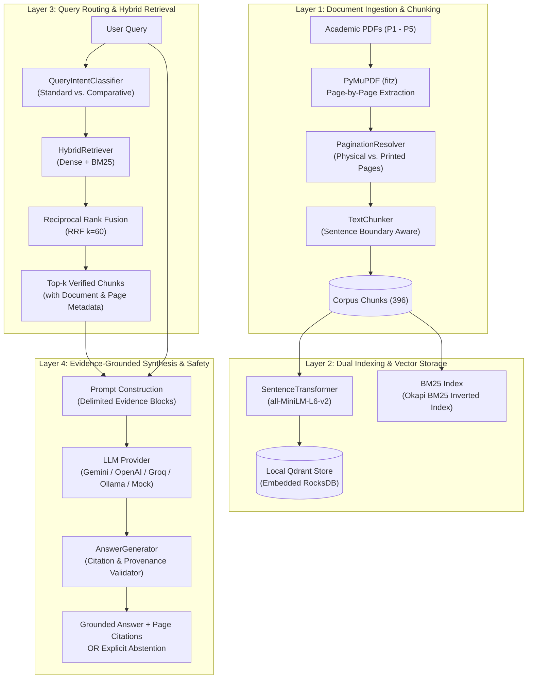

# 00 — Project Overview: Research Intelligence Engine (RIE)

## 1. Executive Summary

**Project Name:** Research Intelligence Engine (RIE)  
**Repository:** `D:\Project\research-intelligence-engine`  
**Core Purpose:** An evidence-grounded research intelligence prototype that synthesizes answers across complex scientific literature with guaranteed, page-level citation provenance and deterministic abstention safeguards.

The Research Intelligence Engine addresses the single greatest vulnerability of standard Retrieval-Augmented Generation (RAG) systems in specialized academic and enterprise domains: **unsupported hallucinations and fabricated citations**. Rather than generating plausible-sounding text from memory or loose context, RIE treats scientific retrieval as a strict evidentiary process where every factual claim must trace directly to a verifiable chunk and physical page number in the source literature, or the system safely abstains.

---

## 2. The Problem Space: Why RIE Matters

### 2.1 The Failure Modes of Naive RAG in Scientific Literature
Standard commercial RAG implementations typically suffer from three severe failure modes when applied to dense technical literature:

1. **Citation Hallucination & Phantom Grounding:** Large Language Models frequently invent convincing paper titles, authors, section numbers, or page numbers when asked to cite sources. Even when passed retrieved context, models often attribute claims to the wrong passage or blend external pre-trained memory with context.
2. **Arbitrary Chunk Boundaries:** Naive fixed-character text splitters (e.g., standard 500-character splitters with arbitrary overlap) routinely sever sentences mid-phrase, isolate mathematical formulas from their definitions, and split citations across chunk boundaries, causing loss of semantic context and keyword mismatches.
3. **Inability to Abstain (Forced Generation):** When standard RAG pipelines receive ambiguous, unanswerable, or out-of-scope queries, they often attempt to generate an answer regardless, using irrelevant top-$k$ passages as a springboard for misleading speculation.
4. **Dense-Only Retrieval Blindspots:** Dense semantic retrieval (bi-encoders) excels at fuzzy conceptual matching but consistently misses exact technical keywords, model names (e.g., `BART-large`, `T5-11B+SSM`), benchmark designations (e.g., `TriviaQA`, `Natural Questions`), and mathematical identifiers that lexical search captures effortlessly.

### 2.2 The RIE Solution
RIE overcomes these vulnerabilities through a multi-tiered architecture combining:
* **Physical Page-Aware Ingestion:** Extraction preserving exact 1-based physical PDF page indexes alongside printed page numbers.
* **Boundary-Aware Text Chunking:** Regex-driven structural chunking preserving complete sentence and paragraph boundaries without clipping words or mathematical notations.
* **Hybrid Reciprocal Rank Fusion (RRF):** Combining 384-dimensional dense semantic vectors (`all-MiniLM-L6-v2` in local persistent Qdrant) with sparse keyword retrieval (Okapi BM25) to achieve an **83.3% Hit@5** retrieval rate (+16.6% absolute gain over dense-only baseline).
* **Deterministic Citation Provenance & Excerpt Reconciliation:** A strict post-generation verification engine that checks every model-emitted citation against actual retrieved chunks, rejecting hallucinated chunk IDs and reconciling paraphrased excerpts with verbatim source text.
* **Deterministic Abstention Safeguards:** A two-tier abstention mechanism that detects out-of-scope queries and insufficient context, producing **0.0% unsupported-answer risk** across benchmark evaluations.

---

## 3. Target Users & Primary Use Cases

Supported directly by the codebase, APIs, and user interfaces, RIE is built for:

| User Persona | Primary Use Case | Key Value Provided |
|---|---|---|
| **AI / NLP Researchers** | Cross-paper literature synthesis across seminal papers (e.g., comparing RAG vs. DPR vs. REALM vs. Self-RAG vs. Ragas). | Rapid comparative analysis with verified page references to check claims in the original PDFs. |
| **System Architects & ML Engineers** | Evaluating production RAG patterns, hybrid retrieval strategies, and evaluation methodologies. | Reference implementation of RRF fusion, local vector databases, and multi-dimensional evaluation. |
| **Enterprise Knowledge Workers & Analysts** | High-stakes technical queries requiring zero tolerance for hallucination or unverified claims. | Guaranteed provenance: if the system answers, the evidence is cited and inspectable; otherwise, it strictly abstains. |

---

## 4. High-Level Architecture

The system is organized into four core operational layers:

---

## 5. Technology Stack

Every technology used in the project was selected for local reproducibility, performance, and deterministic behavior:

| Layer / Concern | Technology | Purpose & Implementation Details |
|---|---|---|
| **Programming Language** | Python 3.10+ (tested on 3.13) | Core engine, ML pipeline, vector database integration, evaluation scripts, and backend service. |
| **Frontend Framework** | Next.js 15+ (React 19, TypeScript) | Modern web interface with research workspace, paper library, system telemetry, and project overview. |
| **Styling & Icons** | Tailwind CSS + Lucide React | Clean, responsive dark-mode styling with high information density and academic aesthetic. |
| **Backend REST API** | FastAPI + Uvicorn | High-throughput asynchronous HTTP API exposing endpoints for Q&A, corpus listing, and paper ingestion. |
| **Fallback / Standalone UI** | Streamlit (1.30+) | Single-process dashboard for rapid local exploration without requiring Node.js. |
| **PDF Processing** | PyMuPDF (`fitz` 1.23+) | High-performance C-based PDF parser extracting text, structural layout, and physical page indices. |
| **Dense Embeddings** | `sentence-transformers` (`all-MiniLM-L6-v2`) | Compact, 384-dimensional dense semantic embedding model running entirely on CPU. |
| **Vector Database** | Qdrant Client (1.7+) | Embedded persistent vector database storing 396 vectors using local RocksDB storage (`data/qdrant/`). |
| **Sparse Lexical Search** | `rank-bm25` (0.2.2+) | Pure-Python Okapi BM25 implementation for exact token matching, acronyms, and model names. |
| **Cross-Encoder Reranker** | `cross-encoder/ms-marco-MiniLM-L-6-v2` | High-accuracy neural reranker for second-stage candidate re-scoring (implemented with CPU guardrails). |
| **LLM Providers** | Google Gemini (`google-genai`), OpenAI (`openai`), Groq (`groq`), Ollama (Local HTTP), Mock Provider | Multi-provider architecture with uniform JSON schema enforcement and offline deterministic simulation. |
| **Data Validation** | Pydantic v2 | Strict schema validation for chunk metadata, retrieval models, API contracts, and evaluation metrics. |
| **Testing & Quality Assurance** | Pytest + Pytest-Asyncio | 20 test modules covering unit, integration, live API, provider error handling, and benchmark integrity. |

---

## 6. Implementation Status Scorecard

To maintain absolute transparency, the following table distinguishes fully implemented functionality from experimental, partial, or planned features:

| Component / Feature | Status | Implementation File / Evidence | Notes & Practical Scope |
|---|:---:|---|---|
| **PDF Ingestion & Page Tracking** | **Fully Implemented** | `src/ingestion/loader.py`, `src/ingestion/pagination.py` | Physical page numbers (1-based) preserved; tested across all 5 benchmark PDFs. |
| **Boundary-Aware Text Chunking** | **Fully Implemented** | `src/chunking/text_chunker.py` | Sentence regex segmentation, token count limits, abbreviation preservation. |
| **Qdrant Vector Storage** | **Fully Implemented** | `src/indexing/vector_store.py` | Embedded RocksDB mode (`data/qdrant/`), 396 points indexed, payload indexing. |
| **Okapi BM25 Lexical Retrieval** | **Fully Implemented** | `src/retrieval/bm25.py` | Custom tokenizer, disk serialization to `data/chunked/corpus_chunks.json`. |
| **Hybrid RRF Fusion** | **Fully Implemented** | `src/retrieval/fusion.py`, `src/retrieval/hybrid.py` | Reciprocal Rank Fusion ($k=60$), combined score calculation, metadata propagation. |
| **Query Intent Routing** | **Fully Implemented** | `src/retrieval/router.py` | Rule-based classifier detecting comparative multi-paper queries; caps per-paper chunks. |
| **Cross-Encoder Reranking** | **Partially Implemented / Experimental** | `src/retrieval/reranker.py` | Fully coded with RAM checks; marked optional/experimental on CPU due to inference cost. |
| **Multi-Provider LLM Integration** | **Fully Implemented** | `src/generation/providers/` | Mock, Google Gemini, OpenAI, Groq, and Ollama providers with uniform interface. |
| **Citation Verification & Excerpt Reconciliation** | **Fully Implemented** | `src/generation/generator.py` | Rejects non-existent chunk IDs; reconciles excerpts with verbatim chunk text. |
| **Abstention Safeguards** | **Fully Implemented** | `src/generation/generator.py` | Triggers on empty retrieval or model abstention; returns 0 citations. |
| **FastAPI Backend Server** | **Fully Implemented** | `src/api/app.py`, `server.py` | Exposes `/api/research/ask`, `/api/papers`, `/api/system/status`, `/api/system/health`. |
| **Next.js 15 Web Application** | **Fully Implemented** | `frontend/src/app/page.tsx` | 4 operational views: Research Workspace, Paper Library, System Telemetry, Project Overview. |
| **Streamlit UI Application** | **Fully Implemented** | `src/ui/app.py`, `app.py` | Standalone single-process dashboard for local execution without Node.js. |
| **Controlled Evaluation Benchmark** | **Fully Implemented** | `scripts/run_answer_quality_evaluation.py` | 5 strictly separated evaluation dimensions across 28 benchmark queries. |
| **Dynamic Document Upload** | **Fully Implemented** | `src/api/routes/papers.py`, `src/ui/service.py` | Supports uploading custom PDFs, chunking, embedding, and incremental Qdrant upsert. |
| **Client-Server Qdrant Mode** | **Planned / Not Implemented** | N/A | Current implementation runs embedded in-process Qdrant; external server mode is roadmap item. |
| **Distributed Session DB** | **Planned / Not Implemented** | N/A | Frontend sessions are stored in browser `localStorage`; persistent database is roadmap item. |

