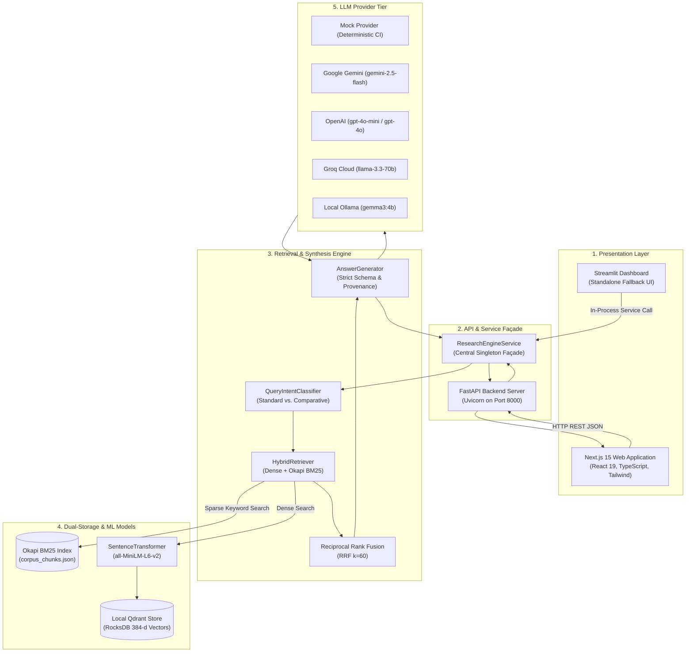
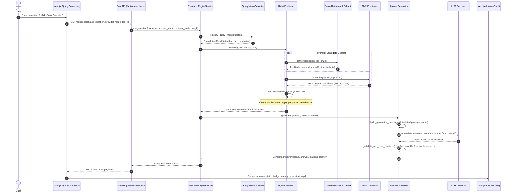
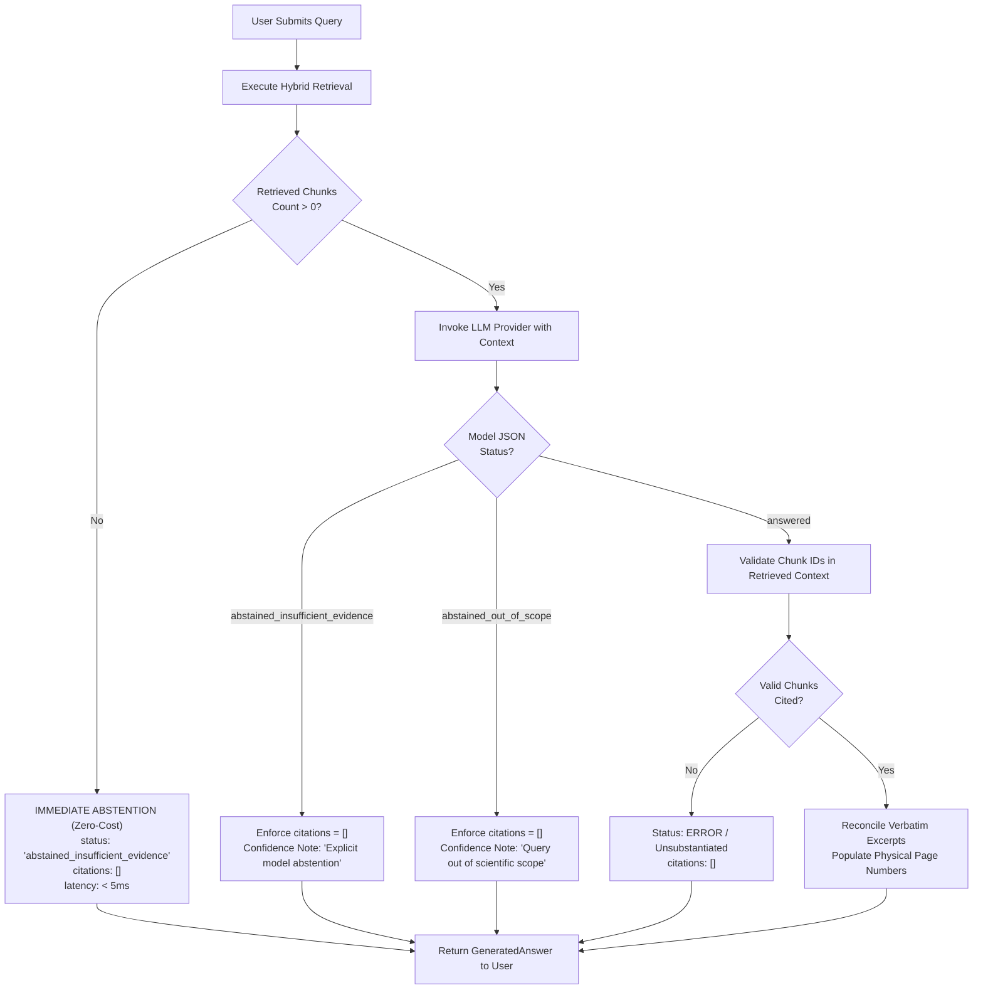
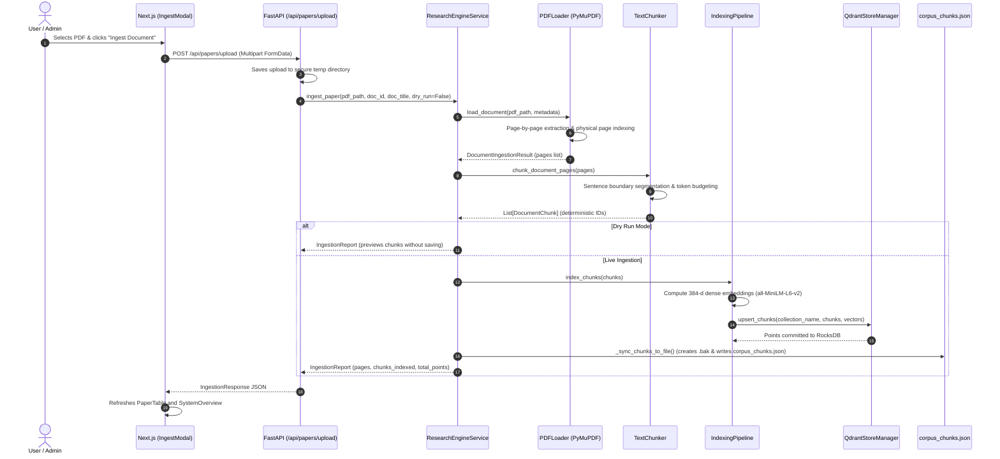

# 03 — System Architecture and Execution Flows

This document details the architectural design and end-to-end execution flows of the **Research Intelligence Engine (RIE)**. Every diagram and numbered trace directly reflects the code paths implemented in `src/` and `frontend/`.

---

## 1. High-Level System Architecture

---

## 2. Execution Flow 1: End-to-End Research Question Answering

This is the primary user journey: a user submits a natural language question and receives an evidence-grounded answer with verified page citations.

### Step-by-Step Breakdown:
1. **Input Submission:** In `QueryComposer.tsx`, the user enters a research question (e.g., *"What generator model does RAG use?"*).
2. **API Dispatch:** `api.askQuestion()` in `frontend/src/lib/api.ts` makes a `POST` request to `http://localhost:8000/api/research/ask`.
3. **Route Handling:** In `src/api/routes/research.py`, `ask_research_question()` validates that the query is non-empty and invokes the shared `ResearchEngineService`.
4. **Intent Classification:** In `src/retrieval/router.py`, `classify_query_intent()` inspects keywords to determine if multi-paper balancing is needed.
5. **Dual Retrieval:** `HybridRetriever.retrieve()` in `src/retrieval/hybrid.py` executes:
   * `DenseRetriever`: Encodes query into 384-d vector via `all-MiniLM-L6-v2` and runs cosine search in Qdrant (`data/qdrant/`).
   * `BM25Retriever`: Tokenizes query and computes Okapi BM25 scores across `data/chunked/corpus_chunks.json`.
6. **Reciprocal Rank Fusion (RRF):** `reciprocal_rank_fusion()` in `src/retrieval/fusion.py` computes combined scores using $k=60$ and ranks candidates.
7. **Prompt Construction:** In `src/generation/prompts.py`, `format_evidence_block()` formats top-$k$ passages into unambiguous delimiters:
   `=== PASSAGE [P1_p03_c02] (Paper: P1, Page: 3) ===`
8. **Model Generation:** Provider adapter (`gemini`, `openai`, `groq`, `ollama`, or `mock`) calls the LLM with `response_format="json_object"`.
9. **Citation Validation & Excerpt Reconciliation:** `AnswerGenerator._validate_and_build_citations()`:
   * Validates each emitted `chunk_id` against retrieved passages; **rejects hallucinated chunk IDs**.
   * Checks model excerpt against source text; if modified, extracts verbatim passage prefix.
   * Populates physical page numbers directly from chunk metadata.
10. **UI Rendering:** In `frontend/src/app/page.tsx`, `AnswerCard` displays the response, latency, and interactive citation badges; `ContextInspector` allows auditing all retrieved context passages.

---

## 3. Execution Flow 2: Deterministic Abstention Safeguard Flow

RIE enforces deterministic abstention to ensure zero hallucination when evidence is absent or out of scope.

### Key Safety Invariants Enforced in Code:
* **Immediate Zero-Cost Abstention:** In `src/generation/generator.py` line 395: If `retrieval_result.chunks` is empty or no chunk passes the similarity threshold, the engine immediately returns `AnswerStatus.ABSTAINED_INSUFFICIENT_EVIDENCE` with empty citations without invoking the LLM provider.
* **Zero Phantom Citations on Abstention:** In `src/generation/generator.py` and unit tests: Whenever `status` is an abstention variant, the citation list is strictly emptied.
* **Hallucination Rejection:** In `src/generation/generator.py` line 145: Any citation referencing a `chunk_id` not present in `chunks_map` is discarded and flagged in `confidence_notes`.

---

## 4. Execution Flow 3: Document Ingestion & Dynamic Index Synchronization

When a new PDF is added via the Web UI (`IngestModal.tsx`) or API (`POST /api/papers/upload`), RIE executes an end-to-end extraction and index synchronization pipeline.

### Safety Features of Ingestion:
1. **Physical Page Number Preservation:** Physical page indices ($1, 2, 3, \dots$) are attached during the initial PyMuPDF pass (`loader.py`), guaranteeing that chunk metadata carries verifiable page coordinates into Qdrant.
2. **Safe File Synchronization with Backup:** In `src/ui/service.py` line 312: Before writing newly ingested chunks to `data/chunked/corpus_chunks.json`, the service writes an automatic backup to `data/chunked/corpus_chunks.json.bak` via `shutil.copy2()`, preventing data loss on disk full or write interruptions.
3. **Idempotent Point IDs:** In `src/indexing/vector_store.py`: Point IDs in Qdrant are generated deterministically using SHA-256 hashes of the chunk ID, ensuring that re-ingesting a document updates existing points rather than duplicating them.

