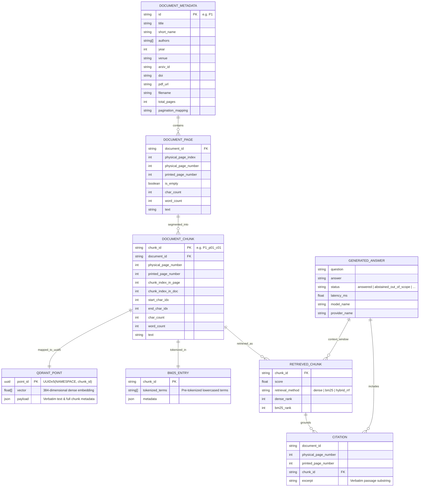

# 05 — Database & Data Architecture

## Executive Summary

The **Research Intelligence Engine (RIE)** employs a dual-index architecture designed for deterministic provenance, reproducible retrieval, and zero external database dependencies. All vector embeddings are persisted locally in **Qdrant** backed by embedded **RocksDB** on the local filesystem, while lexical keyword search is serviced by an in-memory **Okapi BM25** engine constructed directly from a versioned JSON corpus file (`data/chunked/corpus_chunks.json`).

Both stores are synchronized through deterministic UUIDv5 identifier derivation, ensuring that any passage cited by the generation layer can be resolved back to its source document, physical PDF page index, printed page number, and exact character offsets.

---

## 1. Storage Topology & Filesystem Layout

```
research-intelligence-engine/
├── data/
│   ├── papers/                         # Ingested PDF documents and catalog
│   │   ├── metadata.json               # Canonical paper registry (5 papers)
│   │   ├── P1_RAG_2020.pdf             # Lewis et al., 2020 (NeurIPS 2020)
│   │   ├── P2_DPR_2020.pdf             # Karpukhin et al., 2020 (EMNLP 2020)
│   │   ├── P3_REALM_2020.pdf           # Guu et al., 2020 (ICML 2020)
│   │   ├── P4_SelfRAG_2023.pdf         # Asai et al., 2023 (ICLR 2024)
│   │   └── P5_Ragas_2023.pdf           # Es et al., 2023 (EACL 2024)
│   │
│   ├── ingested/                       # Page-level verbatim extraction
│   │   └── extracted_pages.json        # 55 extracted pages with decoupled metadata
│   │
│   ├── chunked/                        # Chunk-level normalized corpus
│   │   ├── corpus_chunks.json          # Primary BM25 & retrieval corpus (396 chunks)
│   │   └── corpus_chunks.json.bak      # Atomic safety backup before synchronization
│   │
│   └── qdrant/                         # Embedded Qdrant vector database (RocksDB)
│       ├── .lock                       # RocksDB exclusive process lockfile
│       └── collection/
│           └── research_corpus/
│               ├── storage.sqlite      # SQLite metadata catalog & schema definitions
│               └── segments/           # RocksDB SSTable segments & vector payloads
│
└── evaluation/
    ├── benchmark_questions.json        # Ground-truth evaluation queries (28 queries)
    └── results/                        # Audited evaluation benchmarks (JSON & Markdown)
```

---

## 2. Qdrant Embedded Vector Database

### 2.1 Configuration & Topology
RIE initializes Qdrant via `QdrantClient(path="data/qdrant")`. In this mode, Qdrant runs in-process inside the Python runtime, bypassing network TCP/gRPC overhead and eliminating external container dependencies. Under the hood, vectors and inverted payload indices are persisted in RocksDB SSTables.

| Parameter | Configured Value | Implementation Source | Description |
| :--- | :--- | :--- | :--- |
| **Collection Name** | `research_corpus` | `src/indexing/models.py` | Isolated namespace for research literature |
| **Vector Dimension** | `384` | `all-MiniLM-L6-v2` | Dense embedding dimensional space |
| **Distance Metric** | `Cosine` | `qdrant_client.models.Distance.COSINE` | Cosine similarity for normalized vectors |
| **Active Points** | `396` | Verified via `get_point_count()` | 1:1 mapping with corpus chunks |
| **Index Type** | `HNSW` | Default Qdrant Configuration | Hierarchical Navigable Small World graph |
| **Storage Engine** | `Embedded RocksDB` | Filesystem at `data/qdrant/` | Embedded C++ storage engine |
| **Process Model** | `Single-Process Exclusive` | System lockfile `data/qdrant/.lock` | Enforces single-writer/reader per runtime |

### 2.2 Deterministic Point ID Generation (UUIDv5)
To avoid non-deterministic auto-increment IDs or random UUIDv4 identifiers, RIE derives every Qdrant point ID deterministically using **RFC 4122 UUIDv5** based on a fixed SHA-1 namespace:

```python
# Defined in src/indexing/vector_store.py:L28
NAMESPACE_RIE_CHUNK = uuid.UUID("3c4d5e6f-7a8b-9c0d-1e2f-3a4b5c6d7e8f")

@staticmethod
def chunk_id_to_point_id(chunk_id: str) -> str:
    """Derive a stable, collision-free UUIDv5 point ID from a chunk ID string."""
    if not chunk_id or not isinstance(chunk_id, str):
        raise VectorStoreError(f"Invalid chunk_id: {chunk_id!r}")
    return str(uuid.uuid5(NAMESPACE_RIE_CHUNK, chunk_id.strip()))
```

*Example Transformation:*
- `chunk_id`: `"P1_p01_c01"`
- `point_id`: `"e601272c-29ef-50ca-9df1-f3b7915ec584"`

This enables idempotent upserts, collision-free point lookups, and instantaneous point retrieval via `get_point_by_chunk_id(collection_name, chunk_id)`.

### 2.3 Point Payload Schema
Each vector in `research_corpus` is bundled with a rich JSON payload storing verbatim source text and provenance metadata:

```json
{
  "chunk_id": "P1_p01_c01",
  "document_id": "P1",
  "document_title": "Retrieval-Augmented Generation for Knowledge-Intensive NLP Tasks",
  "physical_page_index": 0,
  "physical_page_number": 1,
  "printed_page_number": null,
  "chunk_index_in_page": 0,
  "chunk_index_in_doc": 0,
  "start_char_idx": 0,
  "end_char_idx": 982,
  "char_count": 982,
  "word_count": 142,
  "text": "Retrieval-Augmented Generation for Knowledge-Intensive NLP Tasks\nPatrick Lewis, Ethan Perez..."
}
```

### 2.4 Payload Indexes
During collection initialization (`ensure_collection`), payload indexes are provisioned to optimize filtered queries:
- `document_id`: `PayloadSchemaType.KEYWORD` (enables scoped paper searches, e.g., `document_id == "P1"`).
- `physical_page_number`: `PayloadSchemaType.INTEGER` (enables page-range filtering).

---

## 3. BM25 Lexical Corpus (`corpus_chunks.json`)

### 3.1 Role & File Structure
The lexical search pipeline (`BM25Searcher` in `src/retrieval/bm25_search.py`) loads corpus text directly from `data/chunked/corpus_chunks.json`. 

The file stores a JSON array of 396 chunk objects with identical keys to the Qdrant payload schema:
```json
[
  {
    "chunk_id": "P1_p01_c01",
    "metadata": {
      "chunk_id": "P1_p01_c01",
      "document_id": "P1",
      "document_title": "Retrieval-Augmented Generation for Knowledge-Intensive NLP Tasks",
      "physical_page_index": 0,
      "physical_page_number": 1,
      "printed_page_number": null,
      "chunk_index_in_page": 0,
      "chunk_index_in_doc": 0,
      "start_char_idx": 0,
      "end_char_idx": 982,
      "char_count": 982,
      "word_count": 142
    },
    "text": "Retrieval-Augmented Generation for Knowledge-Intensive NLP Tasks..."
  }
]
```

### 3.2 Dual-Index Synchronization
To prevent corpus drift between dense vectors and lexical tokens, RIE provides an atomic synchronization script:
`python scripts/sync_corpus_indexes.py`

1. **Pre-flight Check:** Inspects `corpus_chunks.json` for schema validity and completeness.
2. **Atomic Backup:** Copies `corpus_chunks.json` to `corpus_chunks.json.bak`.
3. **Qdrant Re-index:** Reads `corpus_chunks.json`, computes embeddings in batches of 32 via `EmbeddingGenerator`, and performs deterministic upsert into Qdrant.
4. **Verification:** Asserts that `qdrant_store.get_point_count("research_corpus") == len(corpus_chunks)`.

---

## 4. Pydantic Data Models & Validation Rules

RIE uses Pydantic V2 models across the entire pipeline. All models enforce `ConfigDict(extra="ignore")` to preserve forward-compatibility and maintain clean separation of concerns.

### 4.1 Document & Page Models (`src/ingestion/models.py`)

```python
class DocumentMetadata(BaseModel):
    id: str                                  # E.g., "P1"
    title: str                               # Full publication title
    short_name: Optional[str] = None         # Canonical name (e.g. "RAG")
    authors: List[str] = Field(default_factory=list)
    year: Optional[int] = None               # E.g., 2020
    venue: Optional[str] = None              # E.g., "NeurIPS 2020"
    arxiv_id: Optional[str] = None           # E.g., "2005.11401"
    doi: Optional[str] = None                # DOI URL
    pdf_url: Optional[str] = None            # Direct download URL
    filename: Optional[str] = None           # Local PDF filename
    total_pages: Optional[int] = None        # Page count
    pagination_mapping: Optional[str] = None # E.g., "physical_minus_4" or "none"
    downloaded: Optional[bool] = None
    pages_verified: Optional[bool] = None

class PageMetadata(BaseModel):
    physical_page_index: int                 # 0-based index (0, 1, 2, ...)
    physical_page_number: int                # 1-based index (1, 2, 3, ...)
    printed_page_number: Optional[int] = None# Nullable; only populated if verified
    is_empty: bool = False
    char_count: int = 0
    word_count: int = 0

class DocumentPage(BaseModel):
    document: DocumentMetadata
    page: PageMetadata
    text: str                                # Verbatim extracted text
```

### 4.2 Chunk Models (`src/chunking/models.py`)

```python
class ChunkMetadata(BaseModel):
    chunk_id: str                            # Deterministic ID: "{doc_id}_p{page:02d}_c{idx:02d}"
    document_id: str                         # E.g., "P1"
    document_title: str                      # Document title for citation rendering
    physical_page_index: int                 # 0-based PDF index
    physical_page_number: int                # 1-based PDF page
    printed_page_number: Optional[int] = None# Verified printed page or None
    chunk_index_in_page: int                 # 0-based chunk index on this page
    chunk_index_in_doc: int                  # 0-based chunk index across document
    start_char_idx: int                      # Start character offset in page text
    end_char_idx: int                        # End character offset in page text
    char_count: int                          # Character length of verbatim chunk
    word_count: int                          # Word count

class DocumentChunk(BaseModel):
    chunk_id: str
    metadata: ChunkMetadata
    text: str                                # Verbatim chunk text
```

### 4.3 Retrieval & Generation Models (`src/retrieval/models.py`, `src/generation/models.py`)

```python
class RetrievedChunk(BaseModel):
    chunk_id: str
    document_id: str
    document_title: str
    physical_page_index: int
    physical_page_number: int
    printed_page_number: Optional[int] = None
    chunk_index_in_page: int
    chunk_index_in_doc: int
    start_char_idx: int
    end_char_idx: int
    char_count: int
    word_count: int
    text: str
    score: float                             # Similarity or RRF fused score
    retrieval_method: Optional[str] = None   # "dense", "bm25", "hybrid_rrf"
    dense_rank: Optional[int] = None
    bm25_rank: Optional[int] = None
    dense_score: Optional[float] = None
    bm25_score: Optional[float] = None

class Citation(BaseModel):
    document_id: str
    document_title: str
    physical_page_number: int
    printed_page_number: Optional[int] = None
    chunk_id: str
    excerpt: str                             # Verbatim substring from chunk

    def formatted_citation(self) -> str:
        if self.printed_page_number is not None:
            page_desc = f"p. {self.physical_page_number} (printed p. {self.printed_page_number})"
        else:
            page_desc = f"p. {self.physical_page_number}"
        return f"[{self.document_id}, {page_desc}, Chunk {self.chunk_id}]"

class GeneratedAnswer(BaseModel):
    question: str
    answer: str
    status: AnswerStatus                     # ANSWERED, ABSTAINED_OUT_OF_SCOPE, etc.
    citations: List[Citation] = Field(default_factory=list)
    retrieved_chunks: List[RetrievedChunk] = Field(default_factory=list)
    confidence_notes: Optional[str] = None
    model_name: str
    provider_name: str
    retrieval_mode: Optional[str] = None
    latency_ms: float = 0.0
    prompt_tokens: Optional[int] = None
    completion_tokens: Optional[int] = None
    total_tokens: Optional[int] = None
```

---

## 5. Entity-Relationship (ER) Diagram



---

## 6. End-to-End Passage Lifecycle

The journey of academic prose from an unparsed PDF into a verified inline citation proceeds through 6 decoupled transformations:

```
[Raw PDF: data/papers/P1_RAG_2020.pdf]
           │
           ▼ (pypdf verbatim extraction)
[DocumentPage: extracted_pages.json]
   - document: {id: "P1", title: "...", pagination_mapping: "none"}
   - page: {physical_page_index: 0, physical_page_number: 1, printed_page_number: null}
   - text: "Retrieval-Augmented Generation for Knowledge-Intensive NLP Tasks..."
           │
           ▼ (RegexSentenceChunker: target=1000 chars, overlap=150 chars)
[DocumentChunk: corpus_chunks.json]
   - chunk_id: "P1_p01_c01"
   - metadata: {start_char_idx: 0, end_char_idx: 982, char_count: 982, word_count: 142}
   - text: "Retrieval-Augmented Generation for Knowledge-Intensive NLP Tasks..."
           │
           ├──────────────────────────────────────────────┐
           ▼ (EmbeddingGenerator)                         ▼ (BM25Searcher)
[Qdrant Point]                                   [In-Memory Inverted Index]
   - ID: UUIDv5("P1_p01_c01")                       - Tokens: ["retrieval-augmented", "generation", ...]
   - Vector: [0.042, -0.015, ..., 0.089] (384-d)    - Term Frequencies: {k1: 1.5, b: 0.75}
   - Payload: {chunk_id, doc_id, text, ...}
           │                                              │
           └──────────────────────┬───────────────────────┘
                                  ▼ (HybridSearchEngine RRF k=60)
                           [RetrievedChunk]
                              - chunk_id: "P1_p01_c01"
                              - score: 0.0328
                              - retrieval_method: "hybrid_rrf"
                                  │
                                  ▼ (LLM Generation + Citation Verification)
                           [GeneratedAnswer]
                              - answer: "RAG models combine parametric and non-parametric memory..."
                              - citation: {chunk_id: "P1_p01_c01", page: 1, excerpt: "Retrieval-Augmented..."}
```

---

## 7. Operational & Concurrency Considerations

### 7.1 RocksDB Lock Contention
Because Qdrant runs in embedded mode via C++ RocksDB bindings, **only one operating system process can open the database directory at any time**:
- When FastAPI (`src/api/main.py`) or Streamlit (`src/ui/streamlit_app.py`) starts, it acquires an exclusive file lock on `data/qdrant/.lock`.
- If an offline indexing script (`scripts/sync_corpus_indexes.py` or `scripts/index_corpus.py`) is run while the API server is active, RocksDB raises a lock acquisition error (`Resource temporarily unavailable` or `IO error: lock hold by another process`).
- **Mitigation:** In the production architecture, offline index builds are executed when the server is idle, or the API service initializes the vector store as a singleton within the lifespan context.

### 7.2 Atomic Write Safety for BM25 JSON
When updating `data/chunked/corpus_chunks.json`, scripts write to a temporary buffer and execute a rename/copy to prevent partial writes if interrupted:
- Backup created at `data/chunked/corpus_chunks.json.bak` prior to modification.
- In-memory validation parses the written file with `json.load()` before completing the process.

