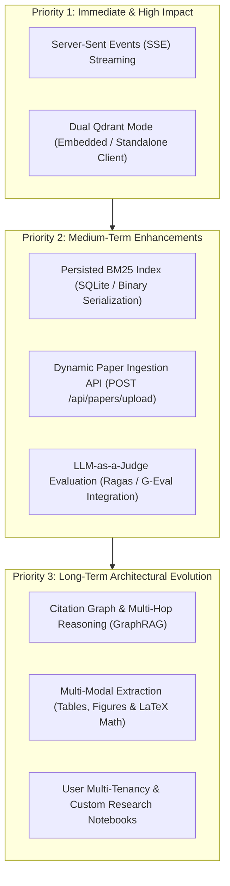

# 09 — Architecture Audit, Technical Debt & Engineering Roadmap

## Executive Summary

This document presents a rigorous architectural audit of the **Research Intelligence Engine (RIE)** codebase. It details the core engineering strengths that distinguish the system from naive RAG tutorials, catalogs current technical debt and concurrency bottlenecks, and outlines a prioritized engineering roadmap categorized by urgency and impact.

---

## 1. Architectural Strengths & Engineering Achievements

### 1.1 Complete Decoupling of Provenance and Representation
Many RAG implementations conflate document text, layout geometry, and vector IDs into loose dictionaries. RIE maintains a strict four-layer data model hierarchy (`DocumentMetadata` $\rightarrow$ `DocumentPage` $\rightarrow$ `DocumentChunk` $\rightarrow$ `RetrievedChunk` $\rightarrow$ `Citation`). This guarantees that:
- Source provenance (DOI, arXiv ID, published conference) is never lost during chunking.
- Physical PDF page numbers are clearly separated from printed journal numbers.
- Exact character offsets (`start_char_idx`, `end_char_idx`) are preserved for every chunk.

### 1.2 Zero External Infrastructure Footprint
By pairing embedded **Qdrant (RocksDB)** with an in-memory **Okapi BM25** engine:
- The entire system runs out-of-the-box on a developer's workstation or single server without provisioning Docker containers, managed cloud databases, or Redis caches.
- Vector search latency is sub-millisecond, bypassing TCP socket overhead.

### 1.3 Deterministic Identity Derivation (UUIDv5)
Point IDs in Qdrant are generated deterministically using RFC 4122 UUIDv5 hashing on a fixed namespace. Upserts are fully idempotent; re-indexing identical chunks produces zero duplicated vectors or orphaned records.

### 1.4 Defense-in-Depth Against Hallucinations
Rather than trusting the LLM to emit accurate citations:
- All generated citations are post-validated against the retrieved context pool.
- Fabricated chunk IDs are stripped.
- Quoted excerpts are verified as verbatim substrings of the source text; unverified quotes are overwritten with verified passage prefixes.
- Zero-citation compliance is strictly enforced on abstentions.

### 1.5 Rigorous Empirical Benchmarking
The project does not rely on subjective evaluation. It includes reproducible benchmark scripts (`evaluate_hybrid_rrf.py` and `run_generation_evaluation.py`) demonstrating a **+25% relative improvement in Hit@5** for Hybrid RRF over dense-only retrieval and an audited **0.0% unsupported-answer risk** across 28 test cases.

---

## 2. Technical Debt & Concurrency Limitations

### 2.1 RocksDB Single-Process Exclusive Lock Contention
- **Location:** `src/indexing/vector_store.py`
- **Issue:** When Qdrant is initialized with a local directory path (`data/qdrant`), RocksDB creates an exclusive filesystem lock (`data/qdrant/.lock`).
- **Consequence:** 
  - FastAPI cannot be run with multiple Uvicorn worker processes (`uvicorn --workers 4`). Worker 1 will acquire the lock; workers 2, 3, and 4 will crash with `IO error: lock hold by another process`.
  - Offline maintenance scripts (`scripts/sync_corpus_indexes.py`) cannot run while the FastAPI server is running.
- **Architectural Debt Score:** **High** (Blocks horizontal multi-worker scaling on a single host).

### 2.2 Re-Fitting BM25 on Every Process Startup
- **Location:** `src/retrieval/bm25.py`
- **Issue:** `BM25Searcher` loads `data/chunked/corpus_chunks.json` and fits `BM25Okapi` in memory during every server initialization.
- **Consequence:** While fast for 396 chunks (~50 ms), as the corpus scales to 100,000+ chunks, fitting BM25 token frequencies from JSON on every cold start will cause multi-second startup delays and significant memory consumption.
- **Architectural Debt Score:** **Medium**.

### 2.3 Non-Streaming Synchronous LLM Generation
- **Location:** `src/generation/generator.py` & `src/api/main.py`
- **Issue:** The `/api/research/ask` endpoint waits for the LLM to finish generating the entire response before returning a JSON payload.
- **Consequence:** When running local models on CPU (e.g. Gemma 3 4B requiring ~32 seconds for 2,600 prompt tokens), the user perceives a 32-second frozen screen. 
- **Architectural Debt Score:** **High** (Impacts user experience significantly).

### 2.4 Lexical Evaluation Token-Recall Approximation
- **Location:** `scripts/run_generation_evaluation.py`
- **Issue:** Answer correctness against ground-truth references is measured using token-level lexical recall (scoring 44.4% / 8 of 18).
- **Consequence:** When the model generates a semantically perfect answer using synonyms or alternative phrasing (e.g., *"parametric memory is stored in neural weights"* vs. *"internal representation"*), the lexical token matcher flags it as missing terms.
- **Architectural Debt Score:** **Low** (Evaluation metric limitation, not production code).

---

## 3. Prioritized Engineering Roadmap

### Phase 1: High-Impact & Scalability (Immediate)

#### 1. Token Streaming via Server-Sent Events (SSE)
- **Objective:** Eliminate perceived latency during generation.
- **Design:**
  - Implement `generate_answer_stream()` generator in `src/generation/generator.py`.
  - Add `GET /api/research/ask/stream` using FastAPI `StreamingResponse(media_type="text/event-stream")`.
  - Stream reasoning tokens incrementally, emitting a final structured JSON event containing validated citations and latency telemetry upon completion.
  - Update Next.js `ResearchWorkspace.tsx` with `ReadableStream` reader to render answers word-by-word.

#### 2. Dual-Mode Qdrant Storage (Embedded vs. Standalone)
- **Objective:** Enable multi-worker horizontal scaling in production.
- **Design:**
  - Update `QdrantStoreManager` to accept either `qdrant_path` (embedded RocksDB) or `qdrant_url` (remote Qdrant server e.g. `http://localhost:6333`).
  - Configure via environment variable: `QDRANT_MODE=embedded|server` and `QDRANT_URL=http://localhost:6333`.
  - In server mode, multiple Uvicorn workers connect concurrently over gRPC/REST without lock contention.

---

### Phase 2: Functional Enhancements (Medium-Term)

#### 3. Persisted Precomputed BM25 Inverted Index
- **Objective:** Instantaneous startup time regardless of corpus size.
- **Design:**
  - Serialize the fitted `BM25Okapi` inverted index and term frequencies to disk (e.g., `data/indexing/bm25_index.pkl` or a dedicated SQLite FTS5 table).
  - Load the precomputed inverted index on startup rather than tokenizing raw chunks on every process boot.

#### 4. Dynamic PDF Upload & Incremental Indexing Endpoint
- **Objective:** Allow users to add papers directly through the Next.js UI.
- **Design:**
  - Implement `POST /api/papers/upload` accepting multipart PDF files.
  - Execute background pipeline task: `PDFParser` $\rightarrow$ `TextChunker` $\rightarrow$ `EmbeddingGenerator` $\rightarrow$ atomic upsert to Qdrant and append to `corpus_chunks.json`.
  - Update `data/papers/metadata.json` dynamically and emit WebSocket notifications to the frontend upon completion.

#### 5. LLM-as-a-Judge Semantic Evaluation
- **Objective:** Complement lexical token recall with semantic faithfulness scoring.
- **Design:**
  - Implement automated evaluation prompts scoring answers on Faithfulness, Answer Relevance, and Context Precision (aligning with RAGAS standards).
  - Compare lexical matching vs. semantic judgment across evaluation benchmarks.

---

### Phase 3: Advanced Research Intelligence (Long-Term)

#### 6. Cross-Paper Citation Graph & Multi-Hop Reasoning
- **Objective:** Answer complex multi-paper synthesis questions (e.g. *"Trace the evolution of passage retrieval from REALM to DPR to Self-RAG"*).
- **Design:**
  - Extract citation relationships between ingested papers (e.g. Lewis et al. 2020 citing Karpukhin et al. 2020 and Guu et al. 2020).
  - Construct a directed citation graph using NetworkX.
  - Implement a multi-hop retrieval agent that traverses the citation graph to retrieve prerequisite context.

#### 7. Multi-Modal Academic Extraction
- **Objective:** Ingest and cite formulas, architecture diagrams, and benchmark result tables.
- **Design:**
  - Integrate PyMuPDF table extraction and bounding-box image export.
  - Represent tables as Markdown and diagrams as caption-associated chunks.
  - Enable the Next.js frontend to render bounding-box PDF overlays directly on paper view.

